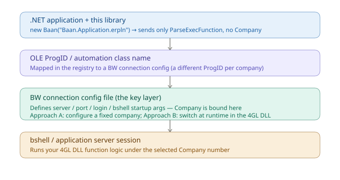

# Wangcaisoft.DotNet.BaanWindowsLib

[](https://github.com/cuiwenyuan/infor-bw-dotnet-baanlib/actions/workflows/ci.yml)
[](LICENSE)

> 🌐 Language / 语言: [English](README.md) · [中文](README.zh-CN.md)

An enhanced and extended .NET port of [mfussenegger/baanlib](https://github.com/mfussenegger/baanlib)
— a wrapper around the Baan/Infor LN OLE automation object (`Baan.Application.*`) that adds a more
natural .NET API plus several productivity enhancements.

Instead of having to build the call string by hand:

```csharp
// The "raw" OLE automation equivalent
dynamic baan = Activator.CreateInstance(Type.GetTypeFromProgID("Baan.Application.erpln"));
baan.Timeout = 3600;
baan.ParseExecFunction("odll_name", "some.function.name(\"with\", \"a\", \"few\", \"arguments\")");
baan.Quit();
```

…`Wangcaisoft.DotNet.BaanWindowsLib` lets you write it the natural way, with the DLL/object name, function path and
arguments expressed as chained member access:

```csharp
using Wangcaisoft.DotNet.BaanWindowsLib;

using (var b = new Baan("Baan.Application.erpln"))
{
    b.odll_name.some.function.name("with", "a", "few", "arguments");

    int var = 1;
    string foo = "test";
    b.odll_name.some.function.name(var, foo);
}
```

## About this enhanced .NET port

`Wangcaisoft.DotNet.BaanWindowsLib` is **not** a line-by-line translation of
[mfussenegger/baanlib](https://github.com/mfussenegger/baanlib). It is an **enhanced and extended
.NET port**: it keeps the original's simple OLE-automation model and API semantics, while adding
.NET-idiomatic productivity features on top:

- **Multi-targeting** — runs on .NET Framework 4.6.2+, and .NET 6 / 8 / 10 (Windows).
- **Structured return values** — `BaanResult` decodes `"code|message"` status strings.
- **Fail-fast option** — `ThrowOnErrorResult` throws `BaanResultException` on a non-zero code.
- **Single-parameter pattern** — pack action + data into one string, decompose on the ERP side.
- **Resilience helpers (optional)** — `BaanResilienceHelper` for RPC recovery, instance retries
  and zombie `bw` cleanup in long-running hosts.
- **Bilingual documentation** and **GitHub Actions CI**.

The original Baan/LN OLE behavior (`ParseExecFunction`, `Error` codes, etc.) is preserved exactly.

## Use Cases

This library is designed for integrating a .NET application (Web API, Windows Service,
desktop client, scheduled job, etc.) with **Infor LN (formerly Baan) ERP**. In Infor LN / Baan
you develop your business logic as a **4GL DLL (object)** and expose its functions through the
OLE automation object. From .NET you can then call those DLL functions directly — no manual OLE
call-string building, no COM plumbing.

## Typical Scenarios

- Trigger Infor LN business actions (create order, post, status change…) from an external system.
- Batch data integration / interface sync, driven from the .NET side.
- Orchestrate multiple DLL-function calls from .NET into a cross-system workflow.

## Quick Start

```bash
dotnet add package Wangcaisoft.DotNet.BaanWindowsLib
```

```csharp
using Wangcaisoft.DotNet.BaanWindowsLib;

// Connect to the Infor LN / Baan OLE automation object
using (var b = new Baan("Baan.Application.erpln"))
{
    // DLL/object name, function path and arguments are expressed as chained member access
    b.odll_name.some.function.name("with", "a", "few", "arguments");

    int var = 1;
    string foo = "test";
    b.odll_name.some.function.name(var, foo);
}
```

To further reduce typing, the API can also be used like this:

```csharp
using (var b = new Baan("Baan.Application.erpln"))
{
    dynamic f = b.ottstpapihand;
    var put = f.stpapi.put.field;

    put("sessioncode", "fieldname1", "value1");
    put("sessioncode", "fieldname2", "value2");

    f.end.session("sessioncode");
}
```

## Single-Parameter Simplification Pattern

When a 4GL DLL function has many or frequently-changing parameters, pack the *action + data* into
**a single string argument** and decompose it inside the DLL function to run the relevant logic.
This keeps the .NET call site stable while the ERP-side logic can evolve without changing the
interface signature.

```csharp
using Wangcaisoft.DotNet.BaanWindowsLib;

using (var b = new Baan("Baan.Application.erpln"))
{
    // Single parameter: action and data packed with a delimiter
    var result = b.odll_name.process("CREATE|ORDER|1001|2026-07-11");
}
```

Corresponding Infor LN / Baan 4GL DLL side (illustrative):

```4gl
function extern long process(string packed)
{
    string action(10), entity(10), key(20), dt(20)
    long   ret

    action = substr$(packed, 1, pos(packed, "|") - 1)
    packed = substr$(packed, pos(packed, "|") + 1)
    entity = substr$(packed, 1, pos(packed, "|") - 1)
    | ... keep decomposing and execute the matching logic
    if (action = "CREATE") {
        ret = dal.create(entity, key, dt)
    }
    return(ret)
}
```

## Return Value Convention (`"code|message"`)

If your 4GL DLL returns a status string in the form `"<code>|<message>"` — for example
`"0|Success"` or `"1|Error"` — decode it into a structured result with `BaanResult` instead of
splitting the string by hand:

```csharp
using Wangcaisoft.DotNet.BaanWindowsLib;

using (var b = new Baan("Baan.Application.erpln"))
{
    var raw = b.odll_name.process("200|CREATE|ORDER|1001"); // returns "0|Success"
    var r = BaanResult.Parse(raw);

    if (!r.IsSuccess)
        Console.WriteLine($"Error {r.Code}: {r.Message}");
}
```

`BaanResult` decodes: `"0|Success"` → `Code = 0, Message = "Success"`; `"1|Error"` →
`Code = 1, Message = "Error"`; a bare number is treated as the code; a string without a delimiter
is treated as a success message. The delimiter is configurable: `BaanResult.Parse(raw, ';')`.

### Fail-fast with `ThrowOnErrorResult`

To make a non-zero code throw automatically instead of returning the raw value, enable
`ThrowOnErrorResult` (off by default, so existing behavior is unchanged):

```csharp
using (var b = new Baan("Baan.Application.erpln"))
{
    b.ThrowOnErrorResult = true;
    b.odll_name.process("200|CREATE|ORDER|1001"); // throws BaanResultException on a "1|..." result
}
```

## Error Handling & Resilience

### Capturing server exception details — `BaanComException`

When a call fails at the COM layer (for example `ParseExecFunction` throws a `COMException`),
the library does **not** lose the failure context. `BaanWrapper` catches the `COMException`,
safely reads back any server-supplied diagnostic text (`ReturnValue` / `ReturnCall`) and rethrows
it as a `BaanComException`. This exception keeps everything needed to diagnose the problem:

| Property | Meaning |
| -------- | ------- |
| `HResult` (base) | Original COM `HResult` (e.g. `0x800706BA`), so you can match known RPC failure codes. |
| `DllName` | The DLL/object name being invoked. |
| `Method` | The method being invoked. |
| `ServerMessage` | Any server-supplied diagnostic text recovered after the failure (may be empty). |
| `InnerException` | The original `COMException`. |

```csharp
try
{
    using var b = new Baan("Baan.Application.erpln");
    b.ThrowOnErrorResult = true;
    b.odll_name.process("200|CREATE|ORDER|1001");
}
catch (BaanComException ex)
{
    Console.WriteLine($"Call {ex.DllName}.{ex.Method} failed (0x{ex.HResult:X8}): {ex.Message}");
    if (!string.IsNullOrEmpty(ex.ServerMessage))
        Console.WriteLine($"Server message: {ex.ServerMessage}");
}
```

### Optional resilience helpers — `BaanResilienceHelper`

`BaanResilienceHelper` is a **standalone, optional** static class. The core `Baan` wrapper does
**not** use it automatically — you wire it in from your own code. It holds higher-level,
production-oriented recovery logic that would be out of place inside a dependency-free OLE wrapper.

| Method | Signature | Description |
| ------ | --------- | ----------- |
| `IsRpcFailure` | `bool IsRpcFailure(Exception ex)` | Returns `true` if `ex` is an RPC/connectivity failure (`0x800706BA`, `0x800706BE`, `0x80010108`) rather than a genuine Baan application error. |
| `CheckServerAvailability` | `BaanServerStatus CheckServerAvailability(string progId)` | Probes the environment: resolves the ProgID, checks the Windows RPC service (`RpcSs`), counts running `bw` processes. Never throws. |
| `EnsureRpcRunning` | `void EnsureRpcRunning()` | Starts the Windows RPC service (`RpcSs`) if it is not already running. Never throws. |
| `KillZombieBwProcesses` | `int KillZombieBwProcesses(int threshold = 10, int maxToKill = 5)` | Kills `bw` processes once their count exceeds `threshold` (stops at `maxToKill`). Intended for a supervised watchdog. Never throws. |
| `CreateInstanceWithRetry` | `object CreateInstanceWithRetry(string progId, int maxRetries = 3, int initialDelayMs = 1000)` | Creates the OLE object with retry + exponential backoff; on an RPC failure it tries to recover the RPC service and retries. Throws `COMException` if all attempts fail. |

`BaanServerStatus` exposes `ProgIdResolved`, `RpcRunning`, `BwProcessCount`, `Message`, plus a
convenience property `IsAvailable` (`ProgIdResolved && RpcRunning`).

**When to use**

Reach for `BaanResilienceHelper` in long-running / server-side hosts where the Baan client is
shared across many calls and a transient RPC failure should not abort the whole process:

- A **Windows Service** / **Web API (ASP.NET)** host that calls Baan on (almost) every request.
- A **scheduled job / batch runner** that issues hundreds of calls and must survive a transient
  RPC blip.
- A **watchdog / supervisor** process that cleans up accumulated zombie `bw` processes.

**When NOT to use** (or only use parts of it):

- You run on **Infor LN Cloud** — there is no BW client / RPC at all (and the whole library is
  unsupported there).
- You make a **single, short-lived call** in a throwaway script — `new Baan(progId)` is enough.
- You want recovery to be invisible to the caller — these helpers are explicit by design, so you
  decide *when* and *how* to recover.
- The `Baan.Application.*` OLE class is not registered on the machine — the helpers only report
  "ProgID not resolved"; they cannot create what does not exist.

**Example**

```csharp
using Wangcaisoft.DotNet.BaanWindowsLib;

string progId = "Baan.Application.erpln";

// 1) Probe the environment (non-intrusive, never throws).
var status = BaanResilienceHelper.CheckServerAvailability(progId);
if (!status.IsAvailable)
    Console.WriteLine($"Baan not ready: {status.Message}");

// 2) Create the OLE object with automatic retry on RPC failure.
try
{
    object ole = BaanResilienceHelper.CreateInstanceWithRetry(progId, maxRetries: 3);
    using dynamic b = new Baan(progId, ole);
    var raw = b.odll_name.process("200|CREATE|ORDER|1001");
    var r = BaanResult.Parse(raw);
    Console.WriteLine(r.IsSuccess ? "OK" : $"Error {r.Code}: {r.Message}");
}
catch (COMException ex) when (BaanResilienceHelper.IsRpcFailure(ex))
{
    // Transient RPC failure even after retries: surface a 503 / retry later.
    Console.WriteLine($"RPC failure after retries: {ex.Message}");
}
```

## Company Configuration (`BSE_COMPNR`)

This library only forwards `ParseExecFunction(dllName, method)` — it does **not** pass a company
number itself. The company is bound to the OLE connection / environment that the ProgID points to,
i.e. it is decided on the **Baan Worktop (BW) client** side, not in .NET code.



**The official way to set the company** is via the BW environment's `set` command using the
environment variable:

```
-set BSE_COMPNR=<compnr>
```

- **Infor ERP Baan 5.0c and later** (including Infor LN): write `-set BSE_COMPNR=200`
- **Infor ERP Baan IVc4**: the *first* occurrence must be written as `"-- -set BSE_COMPNR=200"`
  (note the leading `--`)

Place it in the **Environment (Configuration) command / arguments** of the BW client. In
**BECS (BW Environment and Configuration Selector)** you register an OLE automation name per
environment, and that environment's company is fixed by `BSE_COMPNR`.

> Official reference — Infor LN 10.4 BW install, [set command](https://docs.infor.com/ln/10.4/en-us/lnolh/help/install/bw/in000510.html)

Related `set` variables you can use in the same place:

- `-set PACKAGE_COMB=<packcomb>` — overrides the package combination (overrides user data)
- `set USER=<username>` — changes the user who starts the bshell

### Approach A — one company = one OLE automation name (recommended)

Register a separate OLE automation name per company in BECS, each environment configured with its
own `-set BSE_COMPNR=...`. The .NET side then just picks the ProgID:

```csharp
string progId = companyNo == 100
    ? "Baan.Application.erpln.c100"
    : "Baan.Application.erpln.c200";

using (var b = new Baan(progId))
{
    b.odll_name.some.function.name("arg1", "arg2");
}
```

### Approach B — switch company at runtime (single-parameter pattern)

If you do not want one environment per company, run under a single environment and pass the company
as the first parameter to your own 4GL DLL, which switches company internally before running the
logic:

```csharp
using (var b = new Baan("Baan.Application.erpln"))
{
    // first parameter = company number, the rest is business data
    var result = b.odll_name.process("200|CREATE|ORDER|1001|2026-07-11");
}
```

> Note: `BSE_COMPNR` can only be set when the bshell starts, so it must be configured on the BW side
> (Approach A) or handled inside the 4GL DLL (Approach B). It cannot be set from .NET after the
> `Baan` object is created.

## Requirements

- **Windows only.** The library talks to the Baan/Infor LN OLE automation object via COM.
- One of the following runtimes:
  - .NET Framework **4.6.2** or later
  - .NET **6** (Windows), **.NET 8** (Windows) or **.NET 10** (Windows)
- The Baan/Infor LN client must be installed and its `Baan.Application.*` OLE class registered
  (only required at runtime, not for building or running the unit tests).

## Limitations

- **Windows only.** The library talks to the Baan/Infor LN OLE automation object
  (`Baan.Application.*`) through COM, which is only available on Windows.
- **On-premise / local deployment only — Infor LN Cloud is NOT supported.** The library depends on
  the **Baan Worktop (BW) client**, which provides the `Baan.Application.*` OLE automation object.
  **Infor LN Cloud** (the multi-tenant cloud deployment) does **not** ship or support the BW client,
  so the `Baan.Application.*` OLE class is unavailable there. For LN Cloud integration, use Infor ION
  or the LN SOAP / REST web services instead.

## Installation

```bash
dotnet add package Wangcaisoft.DotNet.BaanWindowsLib
```

## How it works

`Baan` derives from `System.Dynamic.DynamicObject`. Any attribute access that is not one of the
well-known COM properties (`Timeout`, `ReturnValue`, `FunctionCall`, `ReturnCall`, `Binary`)
starts a chain. When the chain is finally invoked, `Wangcaisoft.DotNet.BaanWindowsLib` builds the Baan function string
(numbers are emitted verbatim, everything else is wrapped in double quotes) and calls
`ParseExecFunction(dllName, methodName)`.

After the call it reads the OLE `Error` property:

| `Error` | Throws                       |
| ------- | ---------------------------- |
| `-1`    | `UnknownDllException`        |
| `-2`    | `UnknownMethodException`     |
| other   | returns `ReturnValue`        |

This mirrors the upstream Python implementation exactly.

## API

```csharp
public class Baan : DynamicObject, IDisposable
{
    public Baan(string progId);                 // creates the OLE object, Timeout = 3600
    public Baan(string progId, object baan);    // wraps an existing object (testing/advanced)
    public void Close();                        // calls Quit()
    public void Dispose();                      // -> Close()

    public object Timeout    { get; set; }      // OLE Timeout (seconds)
    public object ReturnValue { get; }          // last ReturnValue
    public object FunctionCall { get; }         // last function call string
    public object ReturnCall   { get; }         // last return call string
    public object Binary       { get; set; }    // binary mode flag
    public bool ThrowOnErrorResult { get; set; } // throw BaanResultException on non-zero code
}

public class BaanWrapper : DynamicObject
{
    public string DllName;        // first segment of the chained path
    public string MethodName;     // remaining segments, joined by '.'
    public string GetCallingMethod(params object[] args); // builds the call string
}

public readonly struct BaanResult
{
    public int Code { get; }        // 0 = success
    public string Message { get; }
    public string Raw { get; }      // original return value
    public bool IsSuccess { get; }  // Code == 0
    public static BaanResult Parse(object returnValue, char delimiter = '|');
}

public class UnknownDllException : Exception { }
public class UnknownMethodException : Exception { }
public class BaanResultException : Exception { public int Code { get; } }

// Raised when a call fails at the COM layer; preserves HResult, DllName, Method, ServerMessage.
public class BaanComException : Exception
{
    public string DllName { get; }       // DLL/object name being invoked
    public string Method { get; }        // method being invoked
    public string ServerMessage { get; } // server diagnostic text (may be empty)
    // base HResult carries the original COM HResult
}

// Optional, standalone resilience helpers (NOT used by Baan automatically).
public static class BaanResilienceHelper
{
    public static bool IsRpcFailure(Exception ex);
    public static BaanServerStatus CheckServerAvailability(string progId);
    public static void EnsureRpcRunning();
    public static int KillZombieBwProcesses(int threshold = 10, int maxToKill = 5);
    public static object CreateInstanceWithRetry(string progId, int maxRetries = 3, int initialDelayMs = 1000);

    public readonly struct BaanServerStatus
    {
        public bool ProgIdResolved { get; }
        public bool RpcRunning { get; }
        public int BwProcessCount { get; }
        public string Message { get; }
        public bool IsAvailable { get; }   // ProgIdResolved && RpcRunning
    }
}
```

## Building and testing

You can build/test a single project or the whole solution (`DotNet.BaanWindowsLib.sln`):

```bash
# Restore, build and test all target frameworks (via the solution)
dotnet build DotNet.BaanWindowsLib.sln -c Release
dotnet test  DotNet.BaanWindowsLib.sln -c Release

# Or target a single project / framework
dotnet build src/DotNet.BaanWindowsLib/DotNet.BaanWindowsLib.csproj -c Release -f net8.0-windows

# Produce a NuGet package
dotnet pack src/DotNet.BaanWindowsLib/DotNet.BaanWindowsLib.csproj -c Release
```

The unit tests use an in-memory fake of the OLE object, so they run without a real Baan/Infor LN
installation (and on CI).

## License

[MIT](LICENSE). This is an independent .NET port of
[mfussenegger/baanlib](https://github.com/mfussenegger/baanlib) (also MIT).
