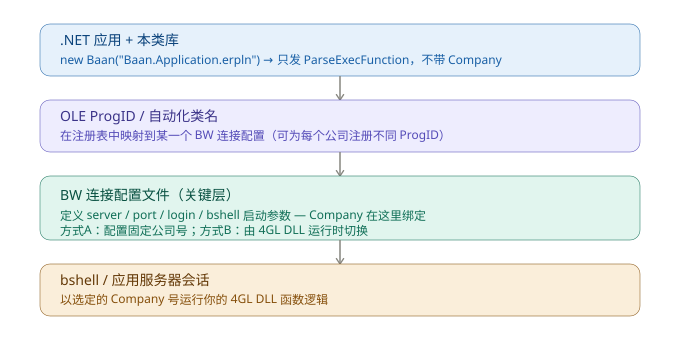

# Wangcaisoft.DotNet.BaanWindowsLib

[](https://github.com/cuiwenyuan/infor-bw-dotnet-baanlib/actions/workflows/ci.yml)
[](LICENSE)

> 🌐 Language / 语言: [English](README.md) · [中文](README.zh-CN.md)

> [!IMPORTANT]
> **.NET 6 / 8 / 10 使用者请注意：你的项目必须使用带 `-windows` 的目标框架。** 本包在新一代 .NET 上只提供
> `net6.0-windows`、`net8.0-windows`、`net10.0-windows` 三个目标框架。如果你的项目用的是普通的
> `net6.0` / `net8.0` / `net10.0`，请把 `<TargetFramework>` 改成对应的 `-windows` 版本（例如
> `net8.0-windows`），否则 NuGet 会拒绝引用本包。详见[环境要求](#环境要求)。（.NET Framework 使用者照常用 `net462`。）

[mfussenegger/baanlib](https://github.com/mfussenegger/baanlib) 的 **.NET 移植增强扩展版本** —— 对 Baan / Infor LN
的 OLE 自动化对象（`Baan.Application.*`）做了轻量封装，并**在原版基础上增加了更符合 .NET 习惯的增强功能**，
让你可以用更自然的 .NET 代码调用 ERP 中的业务逻辑。

不用再手工拼装调用字符串：

```csharp
// 等价的“原始” OLE 自动化写法
dynamic baan = Activator.CreateInstance(Type.GetTypeFromProgID("Baan.Application.erpln"));
baan.Timeout = 3600;
baan.ParseExecFunction("odll_name", "some.function.name(\"with\", \"a\", \"few\", \"arguments\")");
baan.Quit();
```

……使用 `Wangcaisoft.DotNet.BaanWindowsLib`，可以用更自然的方式书写：DLL/对象名、函数路径与参数都以链式成员访问表达：

```csharp
using Wangcaisoft.DotNet.BaanWindowsLib;

using (var b = new Baan("Baan.Application.erpln"))
{
    b.odll_name.some.function.name("with", "a", "few", "arguments");

    int var = 1;
    string foo = "test";
    b.odll_name.some.function.name(var, foo);
}
```

## 关于本移植增强版

`Wangcaisoft.DotNet.BaanWindowsLib` 并非 [mfussenegger/baanlib](https://github.com/mfussenegger/baanlib) 的逐行翻译，
而是一个 **.NET 移植增强扩展版本**：在保留原版简洁的 OLE 自动化模型与 API 语义的同时，增加了符合 .NET 习惯的生产力特性：

- **多目标框架** —— 可运行于 .NET Framework 4.6.2+ 及 .NET 6 / 8 / 10（Windows）。
- **结构化返回值** —— `BaanResult` 解析 `"code|message"` 状态字符串。
- **快速失败选项** —— `ThrowOnErrorResult` 在非 0 Code 时抛出 `BaanResultException`。
- **单参数调用模式** —— 将动作与数据打包为一个字符串，在 ERP 侧拆解执行。
- **弹性辅助类（可选）** —— `BaanResilienceHelper` 提供 RPC 恢复、实例重试与僵尸 `bw` 进程清理，适用于长时间运行的宿主。
- **中英双语文档** 与 **GitHub Actions CI**。

原版 Baan/LN 的 OLE 行为（`ParseExecFunction`、`Error` 错误码等）保持完全一致。

## 用途

本类库用于把 .NET 应用程序（Web API、Windows 服务、桌面程序、定时任务等）与 **Infor LN（原 Baan）ERP**
集成。你只需在 Infor LN / Baan 中把业务逻辑开发成 **4GL DLL（对象）**，并通过 OLE 自动化对象暴露其函数，
即可直接从 .NET 调用这些 DLL 函数——无需手工拼装 OLE 调用字符串，也无需关心底层 COM 细节。

## 典型应用场景

- 从外部系统触发 Infor LN 中的业务动作（创建订单、过账、状态变更等）。
- 批量数据集成 / 接口同步，由 .NET 侧驱动 ERP 逻辑。
- 在 .NET 中编排多个 DLL 函数调用，组合成跨系统的业务流程。

## 快速开始

```bash
dotnet add package Wangcaisoft.DotNet.BaanWindowsLib
```

```csharp
using Wangcaisoft.DotNet.BaanWindowsLib;

// 连接到 Infor LN / Baan 的 OLE 自动化对象
using (var b = new Baan("Baan.Application.erpln"))
{
    // DLL/对象名、函数路径、参数都以链式成员访问表达
    b.odll_name.some.function.name("with", "a", "few", "arguments");

    int var = 1;
    string foo = "test";
    b.odll_name.some.function.name(var, foo);
}
```

可以进一步减少重复输入，像下面这样使用：

```csharp
using (var b = new Baan("Baan.Application.erpln"))
{
    dynamic f = b.ottstpapihand;
    var put = f.stpapi.put.field;

    put("sessioncode", "fieldname1", "value1");
    put("sessioncode", "fieldname2", "value2");

    f.end.session("sessioncode");
}
```

## 单参数简化调用模式

当 4GL DLL 函数的参数较多或经常变化时，可以把“动作 + 数据”打包成**一个字符串参数**，在 DLL 函数内部再
拆解并执行对应的逻辑。这样 .NET 侧调用保持稳定，ERP 侧的逻辑调整不需要改动接口签名。

```csharp
using Wangcaisoft.DotNet.BaanWindowsLib;

using (var b = new Baan("Baan.Application.erpln"))
{
    // 只传一个参数：动作与数据用分隔符打包
    var result = b.odll_name.process("CREATE|ORDER|1001|2026-07-11");
}
```

对应 Infor LN / Baan 4GL DLL 侧（示意）：

```4gl
function extern long process(string packed)
{
    string action(10), entity(10), key(20), dt(20)
    long   ret

    action = substr$(packed, 1, pos(packed, "|") - 1)
    packed = substr$(packed, pos(packed, "|") + 1)
    entity = substr$(packed, 1, pos(packed, "|") - 1)
    | ... 继续拆解并执行对应逻辑
    if (action = "CREATE") {
        ret = dal.create(entity, key, dt)
    }
    return(ret)
}
```

## 返回值约定（"code|message"）

如果你的 4GL DLL 按 `"<code>|<message>"` 形式返回状态字符串——例如 `"0|Success"` 或 `"1|Error"`——
可用 `BaanResult` 直接解析成结构化结果，无需自己拆字符串：

```csharp
using Wangcaisoft.DotNet.BaanWindowsLib;

using (var b = new Baan("Baan.Application.erpln"))
{
    var raw = b.odll_name.process("200|CREATE|ORDER|1001"); // 返回 "0|Success"
    var r = BaanResult.Parse(raw);

    if (!r.IsSuccess)
        Console.WriteLine($"错误 {r.Code}: {r.Message}");
}
```

`BaanResult` 的解析规则：`"0|Success"` → `Code = 0, Message = "Success"`；`"1|Error"` →
`Code = 1, Message = "Error"`；纯数字当作 Code；没有分隔符的字符串当作成功消息。分隔符可配置：
`BaanResult.Parse(raw, ';')`。

### 用 ThrowOnErrorResult 实现 fail-fast

若希望非 0 的 Code 直接抛异常（而不是返回原始值），开启 `ThrowOnErrorResult`
（默认关闭，因此现有行为不变）：

```csharp
using (var b = new Baan("Baan.Application.erpln"))
{
    b.ThrowOnErrorResult = true;
    b.odll_name.process("200|CREATE|ORDER|1001"); // 返回 "1|..." 时抛出 BaanResultException
}
```

## 错误处理与弹性（容错）

### 捕获服务器异常详情 —— BaanComException

当调用在 COM 层失败（例如 `ParseExecFunction` 抛出 `COMException`）时，类库**不会丢失失败上下文**。
`BaanWrapper` 会捕获 `COMException`，安全地回读服务器可能写入的诊断信息（`ReturnValue` / `ReturnCall`），
并以 `BaanComException` 重新抛出。该异常保留了诊断所需的一切：

| 属性 | 含义 |
| ---- | ---- |
| `HResult`（基类） | 原始 COM `HResult`（如 `0x800706BA`），便于匹配已知的 RPC 失败码。 |
| `DllName` | 正在调用的 DLL/对象名。 |
| `Method` | 正在调用的方法。 |
| `ServerMessage` | 失败后尽力恢复到的服务器诊断文本（可能为空）。 |
| `InnerException` | 原始 `COMException`。 |

```csharp
try
{
    using var b = new Baan("Baan.Application.erpln");
    b.ThrowOnErrorResult = true;
    b.odll_name.process("200|CREATE|ORDER|1001");
}
catch (BaanComException ex)
{
    Console.WriteLine($"调用 {ex.DllName}.{ex.Method} 失败 (0x{ex.HResult:X8})：{ex.Message}");
    if (!string.IsNullOrEmpty(ex.ServerMessage))
        Console.WriteLine($"服务器消息：{ex.ServerMessage}");
}
```

### 可选的弹性辅助类 —— BaanResilienceHelper

`BaanResilienceHelper` 是一个**独立、可选**的静态类。核心的 `Baan` 包装**不会**自动使用它——需要你在
自己的代码中手动接线。它封装了更高层、面向生产的恢复逻辑，这部分内容若放进零依赖的 OLE 包装里并不合适。

| 方法 | 签名 | 说明 |
| ---- | ---- | ---- |
| `IsRpcFailure` | `bool IsRpcFailure(Exception ex)` | 判断 `ex` 是否为 RPC/连接类故障（`0x800706BA`、`0x800706BE`、`0x80010108`），而不是真正的 Baan 业务错误。 |
| `CheckServerAvailability` | `BaanServerStatus CheckServerAvailability(string progId)` | 探测环境：解析 ProgID、检查 Windows RPC 服务（`RpcSs`）、统计运行的 `bw` 进程数。永不抛异常。 |
| `EnsureRpcRunning` | `void EnsureRpcRunning()` | 若 Windows RPC 服务（`RpcSs`）未运行则启动它。永不抛异常。 |
| `KillZombieBwProcesses` | `int KillZombieBwProcesses(int threshold = 10, int maxToKill = 5)` | `bw` 进程数超过 `threshold` 时清理（最多 `maxToKill` 个），用于受监管的看门狗。永不抛异常。 |
| `CreateInstanceWithRetry` | `object CreateInstanceWithRetry(string progId, int maxRetries = 3, int initialDelayMs = 1000)` | 带重试与指数退避地创建 OLE 对象；RPC 失败时尝试恢复 RPC 服务并重试。全部失败则抛出 `COMException`。 |

`BaanServerStatus` 包含 `ProgIdResolved`、`RpcRunning`、`BwProcessCount`、`Message`，以及便捷属性
`IsAvailable`（`ProgIdResolved && RpcRunning`）。

**何时使用**

在长时间运行 / 服务端宿主中，Baan 客户端在多次调用间共享，瞬时的 RPC 故障不应导致整个进程崩溃，此时使用
`BaanResilienceHelper`：

- **Windows 服务** / **Web API（ASP.NET）** 宿主，几乎每次请求都要调用 Baan。
- **定时任务 / 批处理** 需要发起成百上千次调用，必须能扛过一次瞬时的 RPC 抖动。
- **看门狗 / 监管进程**，用于清理堆积的僵尸 `bw` 进程。

**不适用场景**（或只使用其中部分方法）：

- 使用 **Infor LN Cloud** —— 根本不存在 BW 客户端 / RPC（而且整个库在云端也不受支持）。
- 在即用即弃的脚本里做**单次、短时调用** —— `new Baan(progId)` 已经足够。
- 希望恢复逻辑对调用方“无感” —— 这些辅助类刻意做成显式调用，由你决定*何时*、*如何*恢复。
- 机器上未注册 `Baan.Application.*` OLE 类 —— 辅助类只会报告“ProgID 未解析”，它无法凭空创建不存在的对象。

**示例**

```csharp
using Wangcaisoft.DotNet.BaanWindowsLib;

string progId = "Baan.Application.erpln";

// 1) 探测环境（非侵入式，永不抛异常）。
var status = BaanResilienceHelper.CheckServerAvailability(progId);
if (!status.IsAvailable)
    Console.WriteLine($"Baan 未就绪：{status.Message}");

// 2) 创建 OLE 对象，RPC 失败时自动重试。
try
{
    object ole = BaanResilienceHelper.CreateInstanceWithRetry(progId, maxRetries: 3);
    using dynamic b = new Baan(progId, ole);
    var raw = b.odll_name.process("200|CREATE|ORDER|1001");
    var r = BaanResult.Parse(raw);
    Console.WriteLine(r.IsSuccess ? "OK" : $"错误 {r.Code}：{r.Message}");
}
catch (COMException ex) when (BaanResilienceHelper.IsRpcFailure(ex))
{
    // 重试后仍是瞬时 RPC 故障：返回 503 / 稍后重试。
    Console.WriteLine($"重试后仍 RPC 故障：{ex.Message}");
}
```

## 公司号配置（BSE_COMPNR）

本类库只透传 `ParseExecFunction(dllName, method)`，**本身不传递公司号**。公司号绑定在 ProgID 所指向的
OLE 连接 / 环境上，即它由 **Baan Worktop（BW）客户端** 一侧决定，而不是在 .NET 代码里。



**设置公司号的官方方式**，是在 BW 环境的 `set` 命令里使用该环境变量：

```
-set BSE_COMPNR=<compnr>
```

- **Infor ERP Baan 5.0c 及以后版本**（含 Infor LN）：写作 `-set BSE_COMPNR=200`
- **Infor ERP Baan IVc4**：第一次出现必须写作 `"-- -set BSE_COMPNR=200"`（注意前面的 `--`）

该命令放在 BW 客户端的 **环境（配置）的 command / arguments** 中。在 **BECS（BW Environment and
Configuration Selector）** 里为每个环境注册一个 OLE 自动化名，该环境的公司号由 `BSE_COMPNR` 固定。

> 官方参考 —— Infor LN 10.4 BW 安装，[set command](https://docs.infor.com/ln/10.4/en-us/lnolh/help/install/bw/in000510.html)

同一位置还可使用的相关 `set` 变量：

- `-set PACKAGE_COMB=<packcomb>` —— 覆盖包组合（覆盖用户数据）
- `set USER=<username>` —— 更改启动 bshell 的用户

### 方式 A —— 一个公司 = 一个 OLE 自动化名（推荐）

在 BECS 中为每个公司注册独立的 OLE 自动化名，每个环境用各自的 `-set BSE_COMPNR=...` 配置公司号。
.NET 侧只需按公司选择 ProgID：

```csharp
string progId = companyNo == 100
    ? "Baan.Application.erpln.c100"
    : "Baan.Application.erpln.c200";

using (var b = new Baan(progId))
{
    b.odll_name.some.function.name("arg1", "arg2");
}
```

### 方式 B —— 运行时切换公司（单参数模式）

若不想为每个公司建环境，可在单一环境下运行，并把公司号作为第一个参数传给自己的 4GL DLL，
由 DLL 内部先切换公司再执行逻辑：

```csharp
using (var b = new Baan("Baan.Application.erpln"))
{
    // 第一个参数 = 公司号，其余为业务数据
    var result = b.odll_name.process("200|CREATE|ORDER|1001|2026-07-11");
}
```

> 注意：`BSE_COMPNR` 只能在 bshell 启动时设置，因此它必须在 BW 侧配置（方式 A），或在 4GL DLL 内部
> 处理（方式 B）。在 `Baan` 对象创建之后，无法从 .NET 再设置公司号。

## 环境要求

- **仅支持 Windows。** 类库通过 COM 与 Baan / Infor LN 的 OLE 自动化对象通信。
- 需要以下运行时之一：
  - .NET Framework **4.6.2** 或更高版本
  - .NET **6 / 8 / 10** —— **必须使用 Windows 目标框架**（见下）
- 运行时所在的机器需安装 Baan / Infor LN 客户端，并注册 `Baan.Application.*` OLE 类
  （仅运行时需要，构建与运行单元测试不要求安装）。

### ⚠️ 你的项目也必须带 `-windows` 目标框架（.NET 6 / 8 / 10）

本包在新一代 .NET 上**只提供 Windows 专用的目标框架（TFM）**：`net6.0-windows`、
`net8.0-windows`、`net10.0-windows`。目标框架为普通 `net6.0`、`net8.0` 或 `net10.0` 的项目
**无法引用本包** —— NuGet 会判定包不兼容。请把**你自己项目**的 TFM 改为带 `-windows` 的版本：

```xml
<!-- 修改前：无法解析 Wangcaisoft.DotNet.BaanWindowsLib -->
<PropertyGroup>
  <TargetFramework>net8.0</TargetFramework>
</PropertyGroup>

<!-- 修改后：加上 -windows 后缀 -->
<PropertyGroup>
  <TargetFramework>net8.0-windows</TargetFramework>
</PropertyGroup>
```

如果你是多目标项目，请为每个新一代 .NET TFM 都加上后缀，例如
`<TargetFrameworks>net462;net8.0-windows;net10.0-windows</TargetFrameworks>`。

之所以必须这样，是因为本库通过 COM 调用 Baan 的 OLE 自动化对象，而 COM 是仅在 Windows 上可用的 API ——
这也正是本库本身仅限 Windows 的原因。这是编译 / 还原阶段的约束，即使你的程序确实运行在 Windows 上也无法绕过。
**.NET Framework 使用者不受影响：** 继续用 `net462` 即可。

## 使用限制

- **仅支持 Windows 平台。** 本类库通过 COM 与 Baan / Infor LN 的 OLE 自动化对象（`Baan.Application.*`）通信，该能力仅在 Windows 上可用。
- **仅适用于本地部署版（On-premise），Infor LN Cloud 不适用。** 本类库依赖 **Baan Worktop（BW）客户端** 提供的 `Baan.Application.*` OLE 自动化对象。**Infor LN Cloud（云端多租户部署）不提供、也不支持 BW 客户端**，因此 `Baan.Application.*` 这个 OLE 类在云端不可用。**对于 LN Cloud 的集成，请改用 Infor ION 或 LN 的 SOAP / REST Web Service。**

## 安装

```bash
dotnet add package Wangcaisoft.DotNet.BaanWindowsLib
```

## 工作原理

`Baan` 继承自 `System.Dynamic.DynamicObject`。任何不属于已知 COM 属性（`Timeout`、`ReturnValue`、
`FunctionCall`、`ReturnCall`、`Binary`）的成员访问都会开启一条调用链。当该链最终被调用时，
`Wangcaisoft.DotNet.BaanWindowsLib` 会拼出 Baan 函数字符串（数字原样输出，其余内容用双引号包裹），
并调用 `ParseExecFunction(dllName, methodName)`。

调用结束后读取 OLE 的 `Error` 属性：

| `Error` | 抛出异常                       |
| ------- | ------------------------------ |
| `-1`    | `UnknownDllException`          |
| `-2`    | `UnknownMethodException`       |
| 其他    | 返回 `ReturnValue`             |

这与上游 Python 实现完全一致。

## API

```csharp
public class Baan : DynamicObject, IDisposable
{
    public Baan(string progId);                 // 创建 OLE 对象，Timeout = 3600
    public Baan(string progId, object baan);    // 包装已有对象（测试/高级用法）
    public void Close();                        // 调用 Quit()
    public void Dispose();                      // -> Close()

    public object Timeout    { get; set; }      // OLE 超时（秒）
    public object ReturnValue { get; }          // 上一次 ReturnValue
    public object FunctionCall { get; }         // 上一次函数调用字符串
    public object ReturnCall   { get; }         // 上一次返回调用字符串
    public object Binary       { get; set; }    // 二进制模式标志
    public bool ThrowOnErrorResult { get; set; } // 非 0 Code 时抛出 BaanResultException
}

public class BaanWrapper : DynamicObject
{
    public string DllName;        // 调用链的第一段（DLL/对象名）
    public string MethodName;     // 其余片段，用 '.' 连接
    public string GetCallingMethod(params object[] args); // 拼出调用字符串
}

public readonly struct BaanResult
{
    public int Code { get; }        // 0 = 成功
    public string Message { get; }
    public string Raw { get; }      // 原始返回值
    public bool IsSuccess { get; }  // Code == 0
    public static BaanResult Parse(object returnValue, char delimiter = '|');
}

public class UnknownDllException : Exception { }
public class UnknownMethodException : Exception { }
public class BaanResultException : Exception { public int Code { get; } }

// 调用在 COM 层失败时抛出；保留 HResult、DllName、Method、ServerMessage。
public class BaanComException : Exception
{
    public string DllName { get; }       // 正在调用的 DLL/对象名
    public string Method { get; }        // 正在调用的方法
    public string ServerMessage { get; } // 服务器诊断文本（可能为空）
    // 基类 HResult 携带原始 COM HResult
}

// 可选的独立弹性辅助类（Baan 不会自动使用）。
public static class BaanResilienceHelper
{
    public static bool IsRpcFailure(Exception ex);
    public static BaanServerStatus CheckServerAvailability(string progId);
    public static void EnsureRpcRunning();
    public static int KillZombieBwProcesses(int threshold = 10, int maxToKill = 5);
    public static object CreateInstanceWithRetry(string progId, int maxRetries = 3, int initialDelayMs = 1000);

    public readonly struct BaanServerStatus
    {
        public bool ProgIdResolved { get; }
        public bool RpcRunning { get; }
        public int BwProcessCount { get; }
        public string Message { get; }
        public bool IsAvailable { get; }   // ProgIdResolved && RpcRunning
    }
}
```

## 构建与测试

可以构建/测试单个项目，也可以构建整个解决方案（`DotNet.BaanWindowsLib.sln`）：

```bash
# 还原、构建并测试所有目标框架（通过解决方案）
dotnet build DotNet.BaanWindowsLib.sln -c Release
dotnet test  DotNet.BaanWindowsLib.sln -c Release

# 或只针对单个项目 / 框架
dotnet build src/DotNet.BaanWindowsLib/DotNet.BaanWindowsLib.csproj -c Release -f net8.0-windows

# 生成 NuGet 包
dotnet pack src/DotNet.BaanWindowsLib/DotNet.BaanWindowsLib.csproj -c Release
```

单元测试使用内存中的 OLE 对象替身（fake），因此无需安装真实的 Baan / Infor LN 即可运行（CI 上亦可）。

## 许可证

[MIT](LICENSE)。本库为 [mfussenegger/baanlib](https://github.com/mfussenegger/baanlib)（同为 MIT）独立的 .NET 移植版本。
